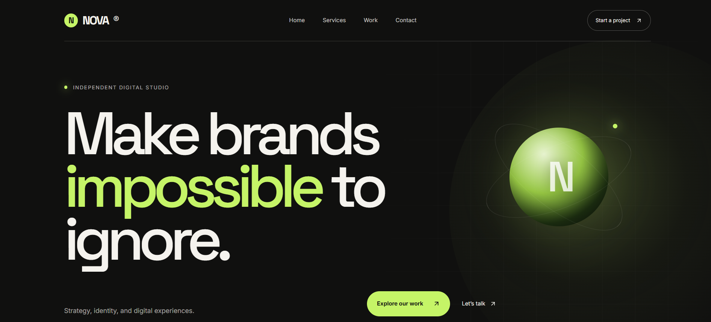

# NOVA® — Digital Design Studio

A responsive, single page homepage for an independent digital design studio. The portfolio concepts are illustrative; the contact form validates and simulates a submission in the browser without sending email.

## Features

- Four homepage sections: Hero, Services, Portfolio, and Contact.
- Dedicated `/services` and `/work` overview pages.
- Individual pages for all four services and four portfolio concepts.
- Lazy-loaded Three.js animations on detail pages, with reduced-motion support.
- Responsive navigation, layout, cards, and form.
- Reusable section and UI components with services and project data separated from presentation.
- Accessible navigation, image descriptions, form labels, field errors, and reduced-motion support.
- Local SVG portfolio artwork rendered with `next/image`.
- SEO metadata and responsive type styling.

## Technology

- Next.js 16 App Router
- React 19 and TypeScript
- Three.js with React Three Fiber for detail-page visuals
- Tailwind CSS 4 with a custom global design system
- Lucide React
- `next/font` with Inter and Space Grotesk

## Structure

```text
src/
  app/                 App Router page, root layout, and global styles
  components/
    layout/            Navbar and footer
    sections/          Hero, services, portfolio, and contact sections
    pages/             Shared service and project detail page templates
    ui/                Buttons, headings, cards, and contact form
    visuals/           Lazy-loaded animated Three.js scenes
  app/
    services/[slug]/   Service detail routes
    work/[slug]/       Project concept detail routes
  data/                Service and project content
  types/               Shared TypeScript types
public/images/portfolio Local illustrative project artwork
```

## Run locally

Requires Node.js 20.9 or later.

```bash
npm install
npm run dev
```

Open [http://localhost:3000](http://localhost:3000).

## Validation and production

```bash
npm run lint
npx tsc --noEmit
npm run build
npm run start
```

## Deployment

Live site: [nova-neon-eta.vercel.app](https://nova-neon-eta.vercel.app/)



Push the project to a GitHub repository and import it in Vercel, or use the Vercel CLI:

```bash
npx vercel
npx vercel --prod
```

The app is a static frontend and needs no environment variables or backend service. The form intentionally does not transmit or persist submissions. The displayed projects are fictional design concepts.
